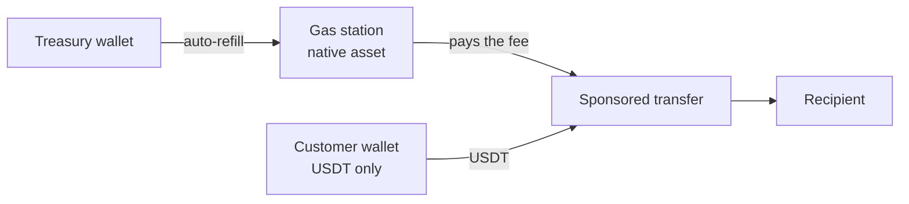

When you hold customer funds in Bitnob Enterprise wallets, every outbound transfer needs native gas at the sending address. With one wallet per customer, keeping ETH or TRX at thousands of addresses quickly becomes unmanageable. A gas station solves this: one balance of the native asset per chain, which pays the fee for any sponsored transfer from your wallets.

## The model

A gas station belongs to your organisation and works on one chain. It has its own on-chain `address`, holding the chain's native asset (`asset` is `ETH`, `TRX`, and so on).

When you send from one of your wallets with sponsorship on, the gas station pays the network fee. The sending wallet only needs the token it is sending.



## Sponsoring a transfer

Set `sponsor: true` on [Create transaction](/api-reference/platform/transactions/create-transaction):

```json
{
  "wallet_id": "a1b2c3d4-5e6f-7a8b-9c0d-1e2f3a4b5c6d",
  "to_address": "TWd4WrZ9wn84f5x1hZhL4DHvk738ns5jwb",
  "asset": "USDT_TRX",
  "amount": "250",
  "sponsor": true
}
```

The transaction response shows the sponsorship:

| Field | Meaning |
|---|---|
| `sponsored` | `true` when the network fee was sponsored. |
| `gas_station_id` | The gas station that paid. |
| `status` | Passes through `awaiting_sponsorship` while the gas station funds the fee, before `broadcasting`. |

To see what sponsorship will cost before you send, pass the same `sponsor: true` to [Estimate transaction fee](/api-reference/platform/transactions/estimate-transaction-fee).

Sponsored transactions still pass through your [policies](/docs/platform/policies/overview). Sponsorship changes who pays the fee, not whether the transfer is allowed.

## Thresholds and auto-refill

Each gas station has a `threshold` in the native asset's display unit, for example `"0.05"` ETH. It drives two things:

- **Health.** `health_status` is `healthy` while the balance is at or above the threshold, and `low` below it.
- **Auto-refill.** With `auto_refill_enabled`, when the balance drops below `threshold`, the gas station pulls `refill_amount` from `refill_from_wallet_id`, a wallet you choose, usually a treasury wallet on the same chain.

You can also top up at any time with [Refill gas station](/api-reference/platform/gasstations/refill-gas-station). A refill is an ordinary transaction from the source wallet, so it is subject to your policies and appears in your transaction history.

<Warning>
  Auto-refill moves funds out of the source wallet, so that wallet needs enough native balance too. If both run dry, sponsored transfers on that chain stop. Watch the source wallet as well as the gas station.
</Warning>

## Alerts

Gas stations emit three webhook events:

| Event | Sent when |
|---|---|
| `gas_station.low_balance` | The balance falls below the threshold. |
| `gas_station.critical_balance` | The balance is close to empty, and sponsored transfers on that chain are at risk. |
| `gas_station.auto_refilled` | An auto-refill completed. |

Route `critical_balance` to whoever can fund the source wallet. A run of `auto_refilled` events at short intervals means `refill_amount` is too small for your volume.

## Units

Gas station fields come in two forms. `threshold` and `refill_amount` are display-unit decimals, such as `"0.25"` ETH, with `_raw` versions in base units. `balance` is **only** in base units, such as wei or sun. Divide it by `10^asset_decimals` before you compare it with `threshold`.

## Sponsoring externally signed Tron transactions

A gas station can also pay for a Tron transaction your system didn't sign through Bitnob. [Sponsor and broadcast](/api-reference/platform/gasstations/sponsor-and-broadcast-external-tron-transaction) takes the signed raw transaction, funds the fee from the gas station, and broadcasts it. The response includes the `sponsor_tx_id` of the fee-funding transaction and the amount sponsored in TRX.

## Gas stations or sponsored transfers

| | Gas station | Sponsored transfer |
|---|---|---|
| Sends from | Your Enterprise wallets | Your users' own addresses |
| You pre-fund | Native asset, per chain | Nothing |
| Fee is paid by | You, in the native asset | The sender, in the token |
| Governed by | Your policies | Your application logic |

If you run both custodial and self-custody flows, you can use both. See [How sponsored transfers work](/docs/platform/gas-sponsorship/how-sponsored-transfers-work).
