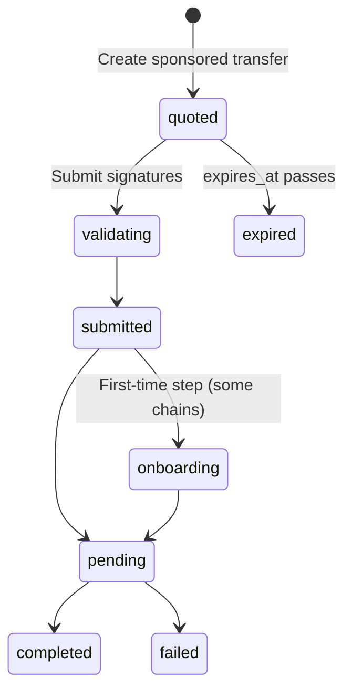

A sponsored transfer has two signers. Your user signs to authorise moving their tokens. Bitnob signs as the operator that pays the network fee. Neither signature is enough alone, and neither party can change what the other signed.

## Who does what

| Party | Holds | Does |
|---|---|---|
| Your user, the sender | Their own key, and the token | Signs the `sign` payload from the quote |
| You, the integrator | Your Bitnob Enterprise API key | Requests the quote, shows it to the user, submits their signature, tracks the result |
| Bitnob | The operator key and the gas | Verifies the user's signature, adds its own, broadcasts, and pays the native fee |

Bitnob never holds the user's key or the user's funds. Tokens go straight from the sender's address to the recipient, and the fee goes to Bitnob in the same transaction.

## The fee model

Bitnob pays the network fee in the native asset and charges a **sponsorship fee** in the token being sent. The quote fixes the fee, so the user sees the exact cost before they sign, whatever happens to gas prices afterwards.

A quote breaks the transfer into parts:

| Field | Meaning |
|---|---|
| `recipient_amount` | What the recipient receives. |
| `fee` | Bitnob's sponsorship fee, with `amount`, `asset`, and a `usd` value. |
| `partner_fee` | Your optional markup, sent to an address you choose. Present only if you asked for one. See [Charge a partner fee](/docs/platform/gas-sponsorship/charge-a-partner-fee). |
| `total_debit` | What leaves the sender's address. |

`total_debit` always equals `recipient_amount` + `fee.amount` + `partner_fee.amount`.

### Net mode and gross mode

`amount` on the quote request means one of two things:

- **Net mode, the default**: `amount` is what the recipient receives. The fees are added on top, so `total_debit` is more than `amount`. Use it for payments, where the recipient must get an exact amount.
- **Gross mode**, with `treat_as_gross_amount: true`: `amount` is the sender's total debit. The fees come out of it, so the recipient gets less than `amount`. Use it to empty an address without overdrawing it. See [Sweep a full balance](/docs/platform/gas-sponsorship/sweep-a-full-balance).

For a 10.50 USDC transfer with a 0.02 USDC fee and no partner fee:

| | `amount` | `recipient_amount` | `fee` | `total_debit` |
|---|---|---|---|---|
| Net | `"10.50"` | `"10.50"` | `"0.02"` | `"10.52"` |
| Gross | `"10.50"` | `"10.48"` | `"0.02"` | `"10.50"` |

The response echoes `treat_as_gross_amount`, so you can check which mode was applied.

Amounts are decimal strings in the token's normal units, for example `"10.50"` USDC. They are not base units.

## Quotes expire

A quote is valid until its `expires_at`, an RFC 3339 timestamp. The user must sign and you must submit before then. After it, Submit returns `409` with `quote_expired`, and you request a new quote.

Keep the time between quote and submit short: request the quote when the user is ready to confirm, not when they open the screen. If the user takes a long time, re-quote, and show the new amounts before they sign again.

## The lifecycle

A signature that doesn't verify doesn't fail the transfer. Submit returns `422` and the quote stays `quoted`, so the user can sign again.

| Status | Meaning |
|---|---|
| `quoted` | Waiting for the user's signature. `sign` and `expires_at` are present. |
| `validating` | Bitnob is checking the signature against the quote. |
| `submitted` | Accepted and queued for broadcast. |
| `assembled` | EVM only. The fully signed transaction has been built. |
| `tron_activating`, `tron_approving` | Tron only, for a first-time sender. Bitnob activates the account and broadcasts the one-time token approval. |
| `pending` | Broadcast and waiting for confirmation. `tx_hash` is set. |
| `completed` | Confirmed on chain. Terminal. |
| `failed` | Did not complete. `failure_code` and `failure_reason` say why. Terminal. |
| `expired` | The quote passed `expires_at` without a valid submission. Terminal. |
| `cancelled` | Cancelled before broadcast. Terminal. |

`onboarding` in the diagram stands for the chain-specific step: `assembled` on EVM, and `tron_activating` or `tron_approving` on Tron. Solana goes straight to `pending`.

## Limits

- **Quote rate.** Requesting quotes too fast returns `429` with `rate_limited`.
- **Daily budget.** Your organisation has a daily sponsored-gas budget. Past it, quotes return `429` with `budget_exceeded` until the budget resets.
- **Capacity.** Rarely, sponsorship capacity is briefly unavailable, and quotes return `503` with `capacity_unavailable`.

Every `429` carries a `Retry-After` header. [Handle failures and expiry](/docs/platform/gas-sponsorship/handle-failures-and-expiry) covers how to respond to each.

## How this differs from Enterprise wallet transfers

Your [policies](/docs/platform/policies/overview) govern what the Bitnob Secure Enclave signs from your own wallets. In a sponsored transfer the sender's funds sit at an address your user controls, and your user signs with their own key. Enforce any per-user limits you need in your own application, before you request the quote.
