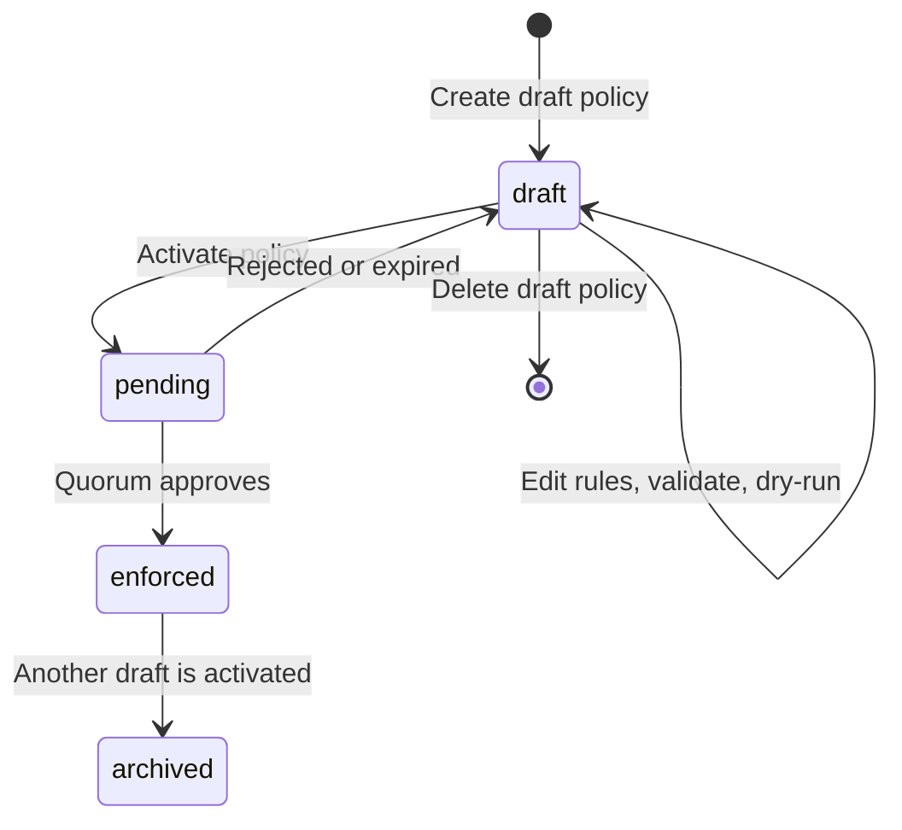

A policy moves through three statuses. Only one transition, activation, changes what your organisation enforces, and that transition always needs more than one person.

## Statuses

| Status | Enforced | Editable | What it means |
|---|---|---|---|
| `draft` | No | Yes | Being written or reviewed. You can change its metadata and add, update, or remove rules. |
| `enforced` | Yes | No | The policy every signing request is evaluated against. Your organisation has at most one. |
| `archived` | No | No | A policy that was enforced and has since been replaced. Kept for audit. |

The `is_active` field on a policy is deprecated. Read `status` instead.



`pending` in the diagram is not a policy status. While activation is waiting for approval, the policy's `status` stays `draft`.

## Drafts are where all editing happens

Every write endpoint except activation works on drafts only:

- [Update draft policy](/api-reference/platform/policies/update-draft-policy) changes the name, description, or category.
- [Add rule](/api-reference/platform/policies/add-rule-to-draft-policy), [Update rule](/api-reference/platform/policies/update-rule-on-draft-policy), and [Remove rule](/api-reference/platform/policies/remove-rule-from-draft-policy) change the rules.
- [Delete draft policy](/api-reference/platform/policies/delete-draft-policy) removes a draft you no longer need.

An enforced policy cannot be edited or deleted. To change what you enforce, create a new draft with the rules you want and activate it. The new policy becomes `enforced` and the old one is `archived`. [Change an enforced policy](/docs/platform/policies/change-an-enforced-policy) walks through this.

## Activation always goes through quorum

[Activate policy](/api-reference/platform/policies/activate-policy) never applies a policy immediately. It stages the draft and opens an approval request, and returns `202 Accepted`:

```json
{
  "approval_request_id": "9b2e7a1c-3d4f-4a8b-9c0d-1e2f3a4b5c6d",
  "policy_id": "f47ac10b-58cc-4372-a567-0e02b2c3d479",
  "required_approvals": 2,
  "status": "pending_authorization",
  "expires_at": "2026-05-17T10:30:00Z"
}
```

The policy becomes `enforced` once the required number of quorum approvers approve the request. If the request is rejected, or reaches `expires_at` without enough approvals, the policy stays `draft` and you can activate it again.

This is the **two-principal invariant**: no single API key, and no single person, can change what your organisation enforces. A compromised key can write a permissive draft, but it cannot make that draft take effect.

### The quorum policy

Who can approve an activation is defined by your organisation's quorum policy, a special policy with category `quorum`. It governs administrative operations that need multi-party approval, including policy activation.

- Configure the quorum in the Bitnob dashboard, with **at least two approvers**. Until it has two, Activate policy returns `422 Unprocessable Entity`.
- Read the current quorum with [Get quorum policy](/api-reference/platform/policies/get-quorum-policy). It returns `404` if none is configured. The quorum policy is not included in [List policies](/api-reference/platform/policies/list-policies).

<Warning>
  Set up the quorum before you go live. Without it you cannot activate any policy through the API, so your organisation runs with no enforced rules.
</Warning>

## Tracking an activation

There is no endpoint for the approval request itself. The `approval_request_id` is for matching the request in the dashboard and in webhook events. Track the outcome on the policy instead:

- Subscribe to the `policy.activated` event, or
- Poll [Get policy](/api-reference/platform/policies/get-policy) until `status` is `enforced`. Stop polling at `expires_at`. If the policy is still `draft`, the request was rejected or expired.

## Audit history

[Get policy audit log](/api-reference/platform/policies/get-policy-audit-log) returns every recorded action on a policy, most recent first. Each entry has the `action` (for example `created`, `updated`, or `activated`), the `actor_id` and `actor_name`, a timestamp, and a `changes` map of the fields that changed. Use it for change review and to answer auditors.

## Approvers in rules

The quorum approves policy changes. A `require_approval` rule in your policy approves transactions, and names its own approvers. These can be individual users or whole roles. [List approver candidates](/api-reference/platform/users/list-approver-candidates) returns both. A role entry covers everyone who holds that role at the time, so approval keeps working when people join or leave. See [Require approval for high-value transfers](/docs/platform/policies/require-approval-for-high-value-transfers).
